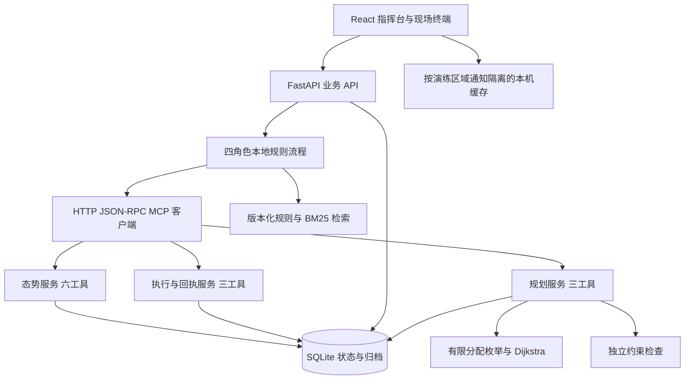
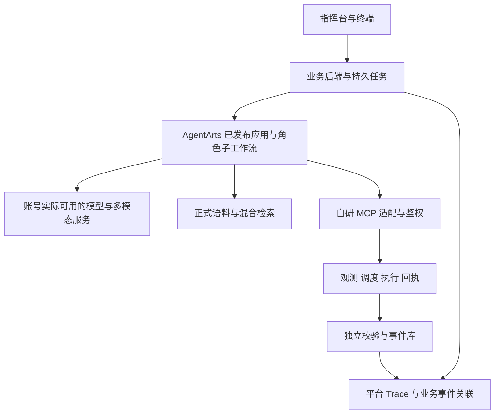

# 架构、能力边界与华为平台迁移

日期：2026-10-22。描述当前 v0.2 实现与拟建设路径。目标架构不能作为现有能力展示。

## 当前可运行架构

MCP 三类服务与业务 API 当前运行在同一个 FastAPI 进程，内部通过真实 HTTP 请求访问。不是三个独立部署的微服务，也不是已接入 AgentArts 的远程服务。`backend/main.py` 为 API/角色流程/MCP，`engine.py` 为业务规则，`planning.py` 为有限求解模型，`store.py` 为事务与归档，`knowledge.py` 为规则索引。

## 状态与约束

| 对象 | 一致性机制 | 边界 |
| --- | --- | --- |
| 演练 | 每次重置生成新编号，事务内检查请求所属演练 | 单实例一个活跃演练，不是账号多租户 |
| 世界快照 | 影响规划的道路、资源、证据变化更新版本 | UI 刷新版本不等于数据库所有事件的递增序号 |
| 方案 | 记录快照、规则语料摘要、约束和内容 SHA-256 | 摘要用于一致性核对，不是数字签名或身份认证 |
| 批准 | 绑定具体方案；新草案替代旧草案/批准；条件变化失效 | 当前操作者为本机演练人员，无生产角色鉴权 |
| 命令 | 幂等键与规范化参数摘要绑定；执行前验证批准 | 同键不同参数拒绝，不把模型输出当成执行结果 |
| 通知 | 每批有目标和消息；只统计当前批次回执 | 旧通知保留历史，不自动累计到新批次 |
| 终端 | 收件箱和待发确认按演练、区域、通知隔离 | 本机存储失败时降为会话内保存并提示 |
| 日志 | 最近 240 条调用摘要 + 累计数 + 全量响应独立持久化 | 旧版记录可能只有摘要，不伪造缺失结果 |

SQLite 使用事务与进程内锁。重置在一次事务中归档旧状态并创建新状态；旧页面、异步任务在事务中不能写入新演练。v0.1 升级前保留数据库备份。归档只读；最近 30 场显示在历史列表，更早记录可按已知编号读取。

## MCP 工具与验证路径

| 服务 | 工具 |
| --- | --- |
| `observation` | `obs_get_snapshot`、`obs_query_station`、`obs_query_route`、`obs_get_evidence`、`obs_request_probe`、`obs_get_probe_result` |
| `planning` | `plan_get_resources`、`plan_optimize`、`plan_validate` |
| `delivery` | `delivery_dispatch_drill`、`delivery_publish_notice`、`delivery_query_receipts` |

路径为 `/mcp/observation`、`/mcp/planning`、`/mcp/delivery`。当前实现 MCP 2025-11-25 的无状态 JSON 调用路径，包含初始化、工具发现、参数检查和错误响应；不提供 SSE/HTTP 会话。完整响应查询位于 `/api/tool-calls/{call_id}`。平台接入能力和传输兼容性必须由账号联调证明。

## 求解范围

固定合成场景为 12 区域、18 路段、2 队伍。每个队伍在当前时窗只接一项任务；便携设备需经领取点获取，电量覆盖运输、部署与 20 分钟预留。`balanced` 按最晚预计恢复排序，`coverage` 按合成人口加权等待排序，同分按行程合计排序。

校验器另行检查演练/快照、内容摘要、保障范围与方式、路径与时间、资源可用性及互斥、电量预算。有限枚举的最优仅限当前声明模型；未考虑真实无线覆盖、道路容量、连续交通、概率灾情、滚动多任务和现场人员安全。移动电源未参加自动分配，R10 拥塞不计为已修复。

## 证据与检索

当前图片、音频仅验证文件类型并保存，不生成模型语义。人工描述采用本地关键词提示历史材料与未知项；这不是可靠的自动事实抽取。原始素材、人工描述和未来模型结果应分别保存。

规则源为 `docs/knowledge/drill-sop.md` 的 8 条自定义演练规则。FTS5 BM25 基于中文字符/双字词与拉丁词检索，返回来源、版本和内容摘要；分数不是置信度。独立合成监测表仅供核实工具使用，不包含在面向前端与 MCP 的快照中；未来盲测真值还需隔离到独立评估端。

## 目标架构与迁移顺序

第一步只打通 `wf_ping`：业务 API 调用已发布工作流，工作流经平台支持的传输调用自研 MCP，返回独立可读回的数据，并记录平台 Trace 与请求编号。`wf_ping` 是团队约定的工作流名称，不是平台预置 API；当前 12 工具没有额外的健康工具，可先用 `obs_get_snapshot` 作为探针。

随后引入角色适配器，统一 `drill_id`、`snapshot_version`、角色输入/输出模式、证据引用、超时和原始返回。任何自动推理都不能绕过计划校验与批准。失败应可见并可重试；切回规则模式必须明确标记。

模型、SIS、知识库、训练和 OBS 的实际服务名、地域、配额与价格，以参赛账号可用服务为准。普通服务器承载 API、索引、MCP、轻量求解与评测；LoRA 训练需另行落实可用加速资源。

## 远程演示前的工程任务

服务默认仅监听 `127.0.0.1`。需要团队远程使用时，先完成有访问控制的 HTTPS 入口、密钥注入、备份恢复、持久任务与进程管理，并在受控演练数据上验证。请求来源检查与 `X-Drill-ID` 不能替代身份鉴权。不要直接把现有服务裸露到公网。

目前没有正式容器部署、账号权限、多租户、外部基站控制或真实警报发送；这些不能从仓库上传推断为已完成。

## 配置与复现

现有变量只有 `UNDELIVERED_DB`、`UNDELIVERED_INTERNAL_URL`、`UNDELIVERED_ALLOWED_ORIGINS`，见根目录 [.env.example](../.env.example)。应用从进程环境读取，不自动读取 `.env`；云变量需随适配器实现补充，避免无效示例让团队误以为已经接入。

公开接口详见本机 `/docs`。团队协作、验证和提交规范见 [CONTRIBUTING](../CONTRIBUTING.md)。
